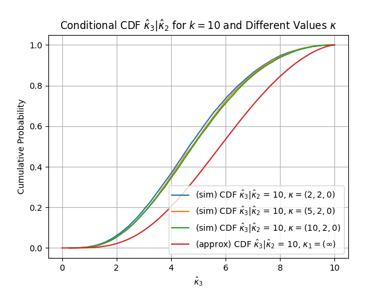

# subvector_AR_HW

Research code accompanying **“Best Feasible Conditional Critical Values for a
More Powerful Subvector Anderson–Rubin Test.”** The repository contains
conditional-eigenvalue illustrations, power comparisons, and the Vietnam
empirical replication.

## Code map

| File | Responsibility |
|---|---|
| `gkm.py` | Conditional eigenvalue densities, CDFs, and critical values used by the feasible tests and illustration. |
| `new_power_comparison.py` | Simulate finite-sample power for the χ², `c₁`, and `c₂`/`c₃` tests. |
| `alfd_eigval.py` | Evaluate Wishart eigenvalue densities, build the reusable null bank, fit null-mixture weights, and calculate the GKM/EMW power-bound curve. |
| `plot_power_comparison.py` | Read saved feasible-test and bound results, then write the combined figure and CSV. |
| `simulation_plot_executable.py` | Interactive illustration of the conditional eigenvalue CDF and its GKM approximation. |
| `empirical_Vietnam.py` | Standalone empirical replication, validation against published results, and HW confidence intervals. |
| `koev/mhg15/mhg_core.c` | Native matrix-hypergeometric evaluator used by the bound calculation. |
| `koev/mhg15/mhg.py`, `koev/mhg15/build.sh` | Python interface and build command for that evaluator. |

Other files under `koev/` preserve the upstream distribution, documentation,
and licence. They are not additional calculation steps.

The power comparison has two independent inputs:

```text
gkm.py → new_power_comparison.py → feasible-test curves ──┐
                                                        ├→ plot_power_comparison.py
native evaluator → alfd_eigval.py → power-bound curve ────┘
```

`alfd_eigval.py` builds the null bank once and reuses it for each beta value.
All these calculations run on one machine; `--workers` selects the number of
local worker processes and can use multiple CPU cores.

## Installation

Use Python 3.10 or later. From the repository root:

```bash
python3 -m venv .venv
source .venv/bin/activate
python -m pip install -r requirements.txt
```

The power-bound calculation also requires a C compiler and a POSIX shell
(macOS or Linux). Build its native library before running `alfd_eigval.py`,
including its help and preflight commands:

```bash
sh koev/mhg15/build.sh
```

The build uses `cc` by default; set `CC` to select another compiler. It writes
the platform-specific library and a source-hash stamp. Rebuild after changing
`mhg_core.c`. The feasible-test simulation, plotting, illustration, and
empirical script do not require this native library.

## Calculate and plot a power comparison

The examples below use configuration `10015` and four CPU cores. Replace
`--workers 4` with the number of cores available for the calculation. Limit
numerical-library threads so each worker does not start another set of threads:

```bash
export OMP_NUM_THREADS=1 OPENBLAS_NUM_THREADS=1 MKL_NUM_THREADS=1
export VECLIB_MAXIMUM_THREADS=1 BLIS_NUM_THREADS=1
```

### 1. Calculate the power bound

Inspect the workload first, then run the same configuration:

```bash
python alfd_eigval.py --version 10015 --profile reference \
  --beta-count 17 --workers 4 --preflight-only

python -u alfd_eigval.py --version 10015 --profile reference \
  --beta-count 17 --workers 4 --acknowledge-expensive
```

The script builds or loads the null bank, fits the mixture for every nonzero
beta, and saves `10015/gkm_direct/gkm_eigval_10015.npz`. The zero-beta value is
exactly the test size, `alpha=0.05`. Progress also goes to
`10015/gkm_direct/bound_run.log`.

These are expensive calculations. `--preflight-only` reports density-pair
counts without simulation. To measure a sample on the target machine, replace
it with `--benchmark-preflight --benchmark-samples 96`. The reference profile
uses 10,000 draws per null, 100,000 alternative draws per beta, and 600 weight
updates. The default production profile uses 2,000, 50,000, and 600 respectively.

To build only the bank, add `--null-bank-only`. Later, omit that option to use
the bank for the curve. Keep the grid, seed, fitting budget, numerical settings,
source, native library, and environment unchanged for reuse.

### 2. Simulate feasible-test power

```bash
python new_power_comparison.py --version 10015 \
  --beta-count 17 --num-simulations 100000 --workers 4 --preflight-only

python -u new_power_comparison.py --version 10015 \
  --beta-count 17 --num-simulations 100000 --workers 4 \
  --acknowledge-expensive --no-show
```

This simulates the χ², `c₁`, and `c₂` tests (`c₃` for a three-nuisance
configuration). It needs neither the bound nor the null bank. Results go to
`10015/dgp/`: `dgp_curves_10015.npz`, a CSV with Monte Carlo standard errors,
a plot, and a run log. Beta zero is simulated in this calculation.

### 3. Combine the saved curves

```bash
python plot_power_comparison.py --version 10015 \
  --bound 10015/gkm_direct/gkm_eigval_10015.npz
```

This writes `10015/power_comparison_10015.png` and a CSV beside it. The plotter
checks that the saved results describe the same experiment. It needs only the
completed result files, not the null bank or compiled native library. Omit
`--bound` to plot feasible-test curves alone.

### Configurations and beta grids

Both calculation scripts use `--version` as a configuration label:

| Label | Nuisance eigenvalues κ | Number of nuisance parameters |
|---|---|---:|
| `1515` | (15, 15) | 2 |
| `3515` | (35, 15) | 2 |
| `5015` | (50, 15) | 2 |
| `10015` | (100, 15) | 2 |
| `352515` | (35, 25, 15) | 3 |
| `1003015` | (100, 30, 15) | 3 |
| `1009590` | (100, 95, 90) | 3 |

The presets use `k=7` instruments, `n=250` observations, and `alpha=0.05`.
The two-nuisance design retains the first two nuisance regressors and the
corresponding covariance block of the Appendix A.3 design.

Choose the final beta grid before starting: `--beta-count` must be odd and
at least three, and gives equally spaced values on `[-2, 2]`. The defaults
are nine points for the bound and 81 for feasible-test power. The two curves
may use different grids; for example, 17 bound points and 81 feasible-test
points give a smoother feasible-test line. Changing the beta grid does not
change the bound's null-grid design, which uses a fixed 81-point design path.
Use `--help` on either script for grid, simulation-budget, and numerical options.

### Saved results and interrupted runs

Simulation outputs, null banks, and logs are ignored by Git. Compatible caches
are reused only when their recorded source hashes, environment, and calculation
settings match. To reuse older caches, use their original code revision and
environment. `--force` explicitly replaces incompatible completed curve results.

The bound driver saves completed beta points in a `.partial.npz` checkpoint.
Rerun the same command to resume; completion replaces it with the final NPZ.
The initial null-bank build is saved only when complete, so an interrupted
initial build must restart. An interrupted feasible-test simulation also
restarts its sweep.

### Meaning of the reported bound

The bound calculation extends GKM Supplement Section D.3.2 to two or three
nuisance parameters. It uses a pooled stratified null bank, ordinary importance
sampling, and the EMW mixture-weight updates. The reported curve is the Step-9
grid-adjusted quantity $\widetilde\pi$. The Step-7 mixture power $\bar\pi$ and
$\epsilon=\bar\pi-\widetilde\pi$ are saved as diagnostics.

The nuisance space is represented by a finite grid of strengths and shapes,
with boundary points and configuration anchors. Hypergeometric truncation
adapts separately for each density evaluation. The resulting values are Monte
Carlo point estimates: their standard errors describe simulation noise, not
error from approximating the continuous nuisance space by a finite grid.
They are not simultaneous confidence bounds.

## Conditional-CDF illustration

```bash
python simulation_plot_executable.py
```

Enter a matrix dimension `p > 2` and a number of instruments `k > p` when
prompted. The script simulates Wishart eigenvalues and opens a Matplotlib
figure comparing the empirical conditional CDF with the GKM approximation.
This illustration is independent of the power-comparison workflow.



## Vietnam empirical replication

The empirical analysis is contained in `empirical_Vietnam.py`. Supply the
original replication files separately under `data/Vietnam/`:

- `20060431_risk.dta`
- `20060431_time.dta`
- `20060431_dofile.do`
- `20060431_ReadMeFile.doc`
- `20060431_ReadMeFile.pdf`

These data and accompanying files are not included in the repository. Once
they are present, run:

```bash
python empirical_Vietnam.py
```

The script checks the original specifications and published benchmarks,
calculates the confidence intervals, and writes tables, figures, grids, and a
log under `results/Vietnam/`. It is independent of both power calculations.
